# Wrong Shell — Workstation Intrusion Investigation

**Threat Hunt Report | Pacific Watch SOC | Windows Endpoint `NL-WS01`**

**Environment:** Simulated SOC investigation in an Azure cyberrange  
**Platform:** Microsoft Sentinel / Azure Log Analytics (KQL)  
**Investigation window:** October 15, 2026, 10:00–17:00 UTC  
**Affected host:** `NL-WS01` (`10.1.10.4`), assigned to `sarah.cole`

## Executive Summary

An IT administrator reported repeated outbound HTTP connections from workstation `NL-WS01` to an unfamiliar destination. Around the same time, the assigned employee reported a suspicious Netflix-themed email containing a link. No SOC detection alert fired, so the investigation began with the network anomaly and a review of Sysmon and Windows Security telemetry.

The evidence traces an external Remote Desktop logon using Sarah Cole's account to the execution of `svchost1.exe`, a malicious-looking executable in her Downloads directory launched with Microsoft Edge as its parent. The process resolved `egravy.com` and contacted `5.182.33.151` and `185.196.9.213` over TCP port 80. Subsequent commands show interactive system discovery, unsuccessful attempts to modify privileges, access to a plaintext credential file, and C2 `download` commands referencing credential and VPN-related documents. The operator then placed `imageloader.exe` in a user Pictures subdirectory and installed a registry Run value to start it at logon.

The confirmed initial-access path was external RDP with valid credentials. The reported email remains contextual information, not a demonstrated entry point. No attacker-associated file-staging operation, successful privilege change, or lateral movement was established in the reviewed records. The exercise indicates that the threat remained uncontained at the end of the hunt window.

## Hunt Scope and Trigger

The investigation covered a single Windows workstation after an IT administrator observed unexpected HTTP traffic. The hunt correlated process, network, DNS, file creation, registry, and authentication events using **`OriginalTime` for event chronology**, rather than the ingestion timestamp `TimeGenerated`.

| Item | Investigation scope |
|---|---|
| SOC | Pacific Watch SOC (cyberrange scenario) |
| Workstation | `NL-WS01` — `10.1.10.4` |
| User | `NL-WS01\sarah.cole` |
| Workspace | `LAW-HuntPractice` |
| Date and time | October 15, 2026, 10:00–17:00 UTC |
| Log sources | `SysmonProcess_CL`, `SysmonNetwork_CL`, `SysmonDNS_CL`, `SysmonFileCreate_CL`, `SysmonRegistryEvent_CL`, `SecurityEvent_CL` |
| Trigger | Repeated outbound HTTP connections; suspicious email reported by user; no SOC alert |

## Key Findings

| Area | Finding |
|---|---|
| Initial access | Successful external authentication and RDP session from `187.15.135.77` using `sarah.cole`'s account. |
| Execution | Microsoft Edge launched `svchost1.exe` (PID `6468`) from the user's Downloads folder at 10:07:52 UTC, in session 2. |
| Command and control | The process resolved `egravy.com` and connected to two external destinations over TCP port 80. |
| Operator activity | Interactive-looking system and directory discovery commands; syntax corrections between Linux- and Windows-style commands. |
| Credential and file access | `passwords.txt` was viewed via `type`; `download` commands targeted that file and `vpn-access-notes.txt`. |
| Privilege changes | Attempts using `net localgroup` and `secedit`; no matching group-addition or rights-assignment audit events observed. |
| Persistence | `imageloader.exe` was created in `Pictures\picture-loader` and referenced by the `image` registry Run value. |
| Final assessment | No internal movement observed in the scoped beacon connections; persistence remained and the threat was not contained. |

## Attack Timeline

All times are **UTC on October 15, 2026**, derived from `OriginalTime` in the underlying telemetry. These are event timestamps, not timestamps of exercise answer submissions.

| Time (UTC) | Activity |
|---|---|
| 10:00:25 | A failed logon for `sarah.cole` is recorded from `84.233.199.115`, a different source from the identified attacker. |
| 10:01:54 | Notepad opens `passwords.txt` under the user's desktop session, before the identified attacker logon. |
| 10:04:22 | Successful Type 3 network logon for `sarah.cole` from `187.15.135.77`; `WorkstationName` is `kali`. |
| 10:04:29 | Successful Type 10 RemoteInteractive (RDP) logon from the same source. |
| 10:07:52 | `msedge.exe` launches `svchost1.exe` (PID `6468`) from Downloads in terminal session 2. |
| 10:07:54 | The beacon resolves `egravy.com` and begins observed HTTP connections. |
| 10:10–10:12 | The operator issues `hostname`, `ipconfig /all`, `net user`, `net localgroup administrators`, `net share`, and `systeminfo` commands. |
| 12:15–12:16 | Attempts to add `sarah.cole` to an administrator group using `net localgroup` variants. |
| 12:20–12:21 | Unix-style `ls` directory commands are followed by Windows `dir` commands. |
| 14:01:10 | A beacon-associated command attempts to display `passwords.txt` using `type`. |
| 14:01:35 | `secedit.exe` is invoked to configure the `USER_RIGHTS` policy area. |
| 14:02:17–14:03:06 | C2 `download` commands reference `passwords.txt` and `vpn-access-notes.txt`. |
| 15:14:41–15:15:54 | An upload command references `sishelper.exe`; a file is created and a deletion command follows. |
| 15:17:39 | The second payload `imageloader.exe` is created under `Pictures\picture-loader`. |
| 15:19:16 | A registry `SetValue` event creates the `image` Run value pointing to `imageloader.exe`. |
| 16:46:33 | Latest connection shown for the beacon's `5.182.33.151:80` destination in the initial network summary. |

## Technical Analysis

### 1. Outbound HTTP Beaconing

The first network summary identified a process named `svchost1.exe` running from `\Users\sarah.cole.NL-WS01\Downloads`, not the usual Windows service path. The process made **20 observed connections to `5.182.33.151:80`** and **7 to `185.196.9.213:80`** during the scoped window. Its filename resembles Windows `svchost.exe`, but the spelling and user-writable location differ materially from the genuine system service.

The query also returned RDP-related activity by the genuine `svchost.exe` and periodic PowerShell DNS activity. Those rows were not attributed to the suspicious beacon.

```kusto
SysmonNetwork_CL
| where Computer contains "NL-WS01"
| extend EventTime = todatetime(OriginalTime)
| where EventTime between (datetime(2026-10-15 10:00:00) .. datetime(2026-10-15 17:00:00))
| summarize
    ConnectionCount = count(),
    FirstSeen = min(EventTime),
    LastSeen = max(EventTime)
    by Image, DestinationIp, DestinationPort, User, Protocol
| order by ConnectionCount desc
```

[Open the saved KQL file](queries/Q01_suspicious_process_network_connections.kql)

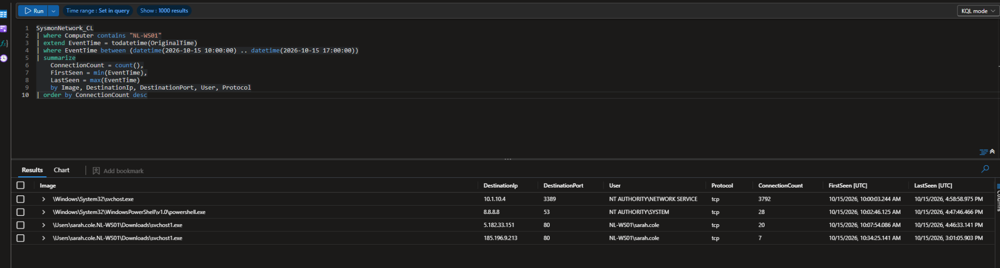

*Evidence: Network connection summary showing the two external HTTP destinations of svchost1.exe.*

DNS telemetry then identified three `egravy.com` lookups from the same executable at **10:07:54**, **10:22:23**, and **10:34:25 UTC**. The DNS answers included both IP addresses found in the network connection evidence. This correlates the domain with the suspicious network behavior; the records do not reveal the content of the HTTP exchanges.

```kusto
SysmonDNS_CL
| where Computer contains "NL-WS01"
| extend EventTime = todatetime(OriginalTime)
| where EventTime between (datetime(2026-10-15 10:00:00) .. datetime(2026-10-15 17:00:00))
| where Image contains "svchost1.exe"
    or QueryResults contains "5.182.33.151"
    or QueryResults contains "185.196.9.213"
| project EventTime, Computer, Image, QueryName, QueryResults
| order by EventTime asc
```

[Open the saved KQL file](queries/Q02_c2_domain_dns_resolution.kql)

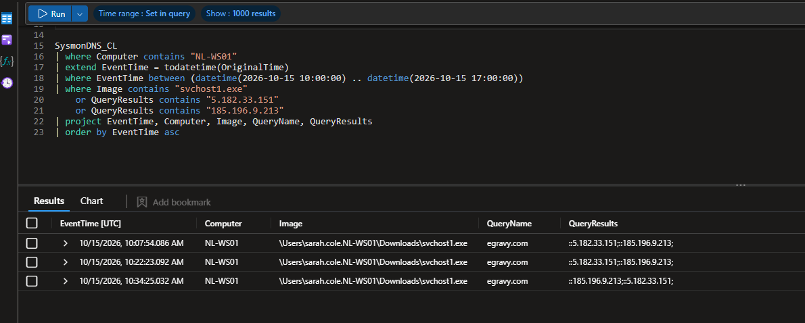

*Evidence: Three egravy.com DNS resolutions associated with the beacon process.*

### 2. Execution and Process Masquerading

Process creation records show that `svchost1.exe` started at **10:07:52.354 UTC** under `NL-WS01\sarah.cole`, with **PID `6468`** and a parent executable of `\Program Files (x86)\Microsoft\Edge\Application\msedge.exe` (parent PID `7536`). The browser-parented execution is consistent with a browser-associated launch, but does not establish which email or URL delivered the file.

The process ran as the interactive user rather than `NT AUTHORITY\SYSTEM`, and did not follow the normal filename, path, or service ancestry expected of Windows `svchost.exe`.

```kusto
SysmonProcess_CL
| where Computer contains "NL-WS01"
| extend EventTime = todatetime(OriginalTime)
| where EventTime between (datetime(2026-10-15 10:00:00) .. datetime(2026-10-15 17:00:00))
| where Image contains "svchost1.exe"
    or CommandLine contains "svchost1.exe"
| project EventTime, Computer, User, Image, CommandLine, ParentImage, ParentProcessId, ProcessId
| order by EventTime asc
```

[Open the saved KQL file](queries/S02_Q01_delivery_application_parent_process.kql)

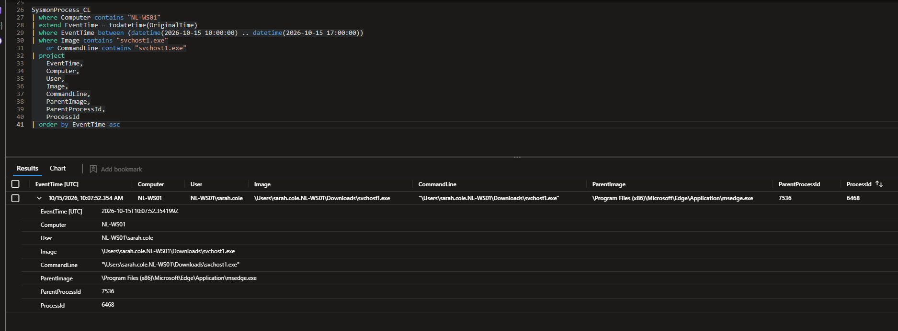

*Evidence: Process creation showing Microsoft Edge as the parent of svchost1.exe.*

The same process was created in **terminal session 2**. The session ID provides execution context, while the separate Windows Security events establish the remote logon mechanism.

```kusto
SysmonProcess_CL
| where Computer contains "NL-WS01"
| extend EventTime = todatetime(OriginalTime)
| where EventTime between (datetime(2026-10-15 10:00:00) .. datetime(2026-10-15 17:00:00))
| where Image contains "svchost1.exe"
| where tostring(ProcessId) == "6468"
| project EventTime, Image, ProcessId, TerminalSessionId, User, ParentImage
| order by EventTime asc
```

[Open the saved KQL file](queries/S02_Q03_terminal_session_context.kql)

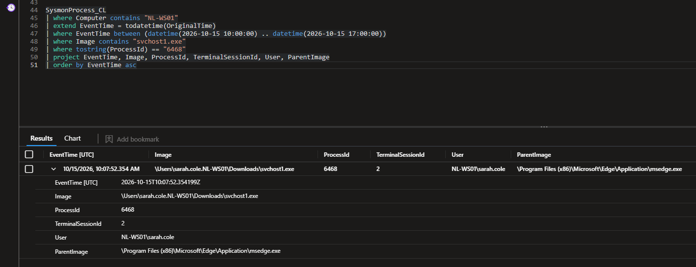

*Evidence: Process PID 6468 running under Sarah Cole in terminal session 2.*

### 3. Initial Access and Authentication

Windows Security Event ID **4624** shows successful authentication for `sarah.cole` from external IP **`187.15.135.77`** at **10:04:22.909 UTC** (Type 3), followed by a **Type 10 RemoteInteractive logon** at **10:04:29.554 UTC**. The beacon started about three minutes later, supporting a sequence of remote access followed by on-host execution. The case identifies internet-exposed RDP with valid account credentials as the access route; the method by which those credentials were obtained was not established.

```kusto
SecurityEvent_CL
| where Computer contains "NL-WS01"
| where tostring(EventID) == "4624"
| extend EventTime = todatetime(OriginalTime)
| where EventTime between (datetime(2026-10-15 10:00:00) .. datetime(2026-10-15 10:10:00))
| project EventTime, Computer, Account, LogonType, IpAddress, Activity
| order by EventTime asc
```

[Open the saved KQL file](queries/S03_Q01_attacker_source_logon_events.kql)

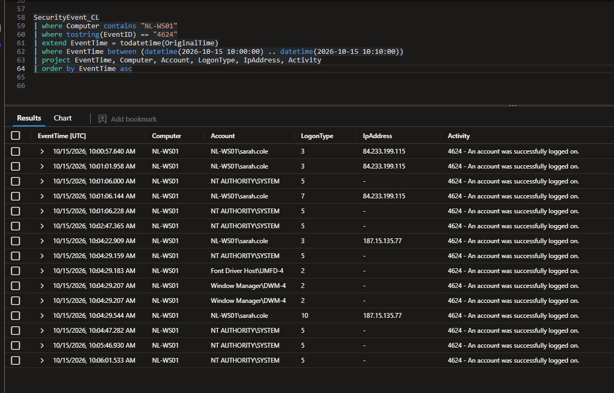

*Evidence: Successful logons, including the attack-associated Type 10 session from 187.15.135.77.*

The earlier Type 3 event recorded **`WorkstationName = kali`** and **NTLM**, while the later RDP event recorded `WorkstationName = NL-WS01` and `Negotiate`. `kali` is the workstation name reported by the log, not independent verification of the remote operating system.

```kusto
SecurityEvent_CL
| where Computer contains "NL-WS01"
| where tostring(EventID) == "4624"
| where IpAddress == "187.15.135.77"
| extend EventTime = todatetime(OriginalTime)
| where EventTime between (datetime(2026-10-15 10:00:00) .. datetime(2026-10-15 10:10:00))
| project EventTime, Account, IpAddress, LogonType, WorkstationName, AuthenticationPackageName
| order by EventTime asc
```

[Open the saved KQL file](queries/S03_Q02_attacker_workstation_name.kql)

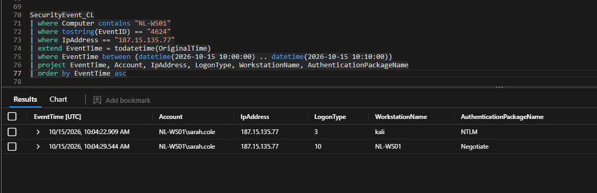

*Evidence: Source workstation name kali from the attack-associated successful logon.*

Two other source IPs, `84.233.199.115` and `187.14.57.251`, appeared in successful logons with the shared workstation name **`DESKTOP-AMOL2RQ`**. This comparison distinguished the identified attacker session from other activity involving the same user account.

```kusto
SecurityEvent_CL
| where Computer contains "NL-WS01"
| where tostring(EventID) == "4624"
| extend EventTime = todatetime(OriginalTime)
| where EventTime between (datetime(2026-10-15 10:00:00) .. datetime(2026-10-15 17:00:00))
| where isnotempty(IpAddress) and IpAddress != "-"
| where IpAddress != "187.15.135.77"
| project EventTime, IpAddress, WorkstationName, Account, LogonType, AuthenticationPackageName
| order by IpAddress asc, EventTime asc
```

[Open the saved KQL file](queries/S03_Q03_legitimate_workstation_logon_comparison.kql)

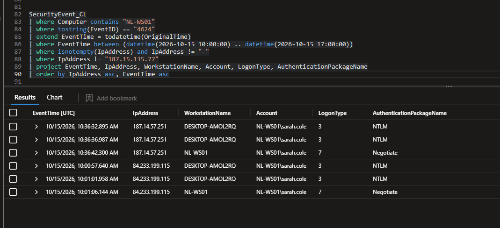

*Evidence: Comparison logons from two IPs sharing the DESKTOP-AMOL2RQ workstation name.*

A focused search of failed logons (Event ID **4625**) returned **one failed login for `sarah.cole` at 10:00:25 UTC from `84.233.199.115`** and no matching failures from the identified attacker IP. A broader search also showed failed attempts against other account names earlier that day. We therefore cannot say there were no failed logons on the workstation; the narrower conclusion is that the available events do not show password guessing by the identified attacker source.

```kusto
SecurityEvent_CL
| where Computer contains "NL-WS01"
| where tostring(EventID) == "4625"
| extend EventTime = todatetime(OriginalTime)
| where EventTime between (datetime(2026-10-15 00:00:00) .. datetime(2026-10-15 17:00:00))
| where Account contains "sarah.cole" or IpAddress == "187.15.135.77"
| project EventTime, Account, IpAddress, LogonType, Activity
| order by EventTime asc
```

[Open the saved KQL file](queries/S03_Q04_failed_logons_focused_account_and_ip.kql)

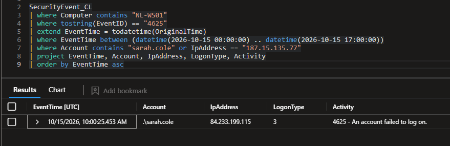

*Evidence: Focused failed logon search showing one Sarah Cole failure from a different source IP.*

### 4. Operator Activity and Privilege Escalation Attempts

Commands associated with the malicious process's PID (`6468`) included host and network reconnaissance (`hostname`, `ipconfig /all`, `net user`, `net share`, and `systeminfo`) and directory enumeration. At **12:20:48** and **12:21:15**, the operator tried `ls` through Windows `cmd.exe`, then switched to `dir` at **12:21:36**. The case reports the first commands failed. The command sequence and syntax corrections are consistent with interactive, hands-on-keyboard operation rather than an entirely fixed script.

```kusto
SysmonProcess_CL
| where Computer contains "NL-WS01"
| extend EventTime = todatetime(OriginalTime)
| where EventTime between (datetime(2026-10-15 10:07:52) .. datetime(2026-10-15 17:00:00))
| where tostring(ParentProcessId) == "6468"
    or ParentImage contains "svchost1.exe"
    or Image endswith @"\cmd.exe"
    or Image endswith @"\powershell.exe"
| project EventTime, User, Image, CommandLine, ParentImage, ParentProcessId, ProcessId
| order by EventTime asc
```

[Open the saved KQL file](queries/S04_Q01_operator_ls_directory_listing.kql)

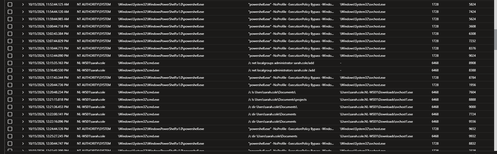

*Evidence: Process records showing ls followed by dir during file and directory discovery.*

Attempts to change permissions followed. At **12:15–12:16 UTC**, the operator ran malformed and corrected `net localgroup` commands aimed at adding Sarah's account to the Administrators group. At **14:01:35 UTC**, they invoked `secedit.exe` with `/configure` and `/areas USER_RIGHTS`, referring to files in the user's temporary directory. These are evidence of attempts to modify local access rights, not proof that the changes took effect.

```kusto
SysmonProcess_CL
| where Computer contains "NL-WS01"
| extend EventTime = todatetime(OriginalTime)
| where EventTime between (datetime(2026-10-15 12:15:00) .. datetime(2026-10-15 17:00:00))
| where tostring(ParentProcessId) == "6468"
    or ParentImage contains "svchost1.exe"
    or User contains "sarah.cole"
| project EventTime, User, Image, CommandLine, ParentImage, ParentProcessId, ProcessId
| order by EventTime asc
```

[Open the saved KQL file](queries/S04_Q02_alternative_escalation_utility.kql)

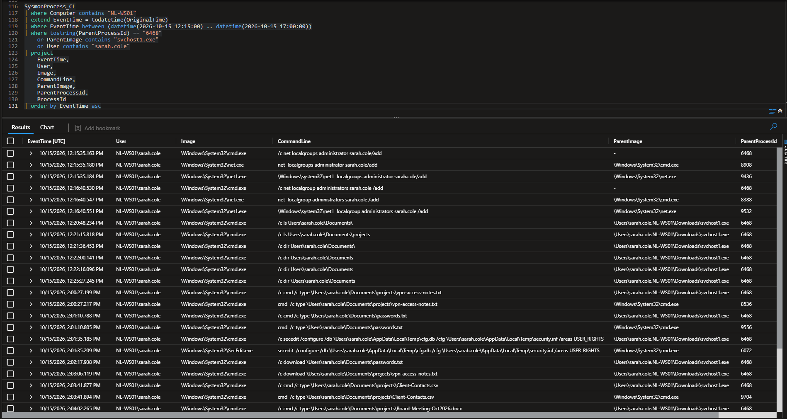

*Evidence: Process activity containing net localgroup attempts, secedit, and subsequent attacker commands.*

A separate check for Windows Security events **4732** (local group membership addition) and **4704** (user right assigned) returned **no results** in the hunt window. No successful privilege escalation was confirmed by these events.

```kusto
SecurityEvent_CL
| where Computer contains "NL-WS01"
| where toint(EventID) in (4732, 4704)
| extend EventTime = todatetime(OriginalTime)
| where EventTime between (datetime(2026-10-15 10:00:00) .. datetime(2026-10-15 17:00:00))
| project EventTime, EventID, Account, Activity
| order by EventTime asc
```

[Open the saved KQL file](queries/S04_Q03_privilege_escalation_security_event_check.kql)

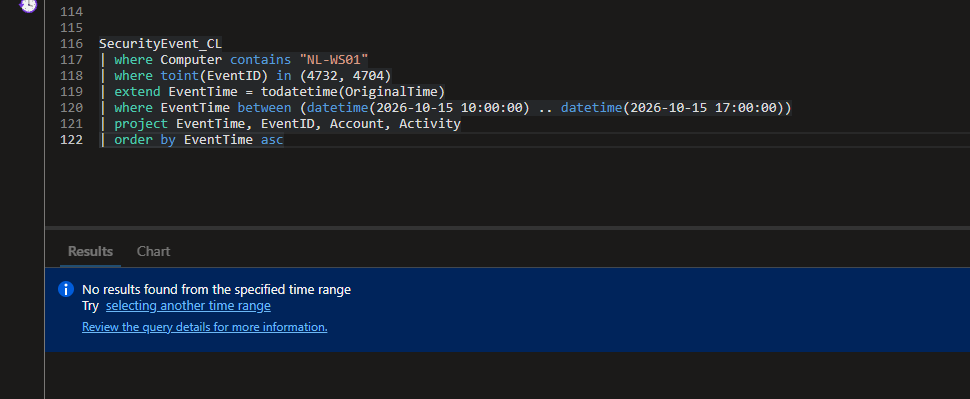

*Evidence: No matching security events confirming group membership changes or rights assignment.*

### 5. Credential Access and C2 File Downloads

The process evidence distinguishes normal access from the attacker's later activity. At **10:01:54 UTC**, `notepad.exe`, launched by `explorer.exe`, referenced `\Users\sarah.cole\Documents\passwords.txt`. At **14:01:10 UTC**, a `cmd.exe` process associated with the beacon executed a `type` command against the same file. A subsequent C2 `download` command referenced it at **14:02:17 UTC**.

```kusto
SysmonProcess_CL
| where Computer contains "NL-WS01"
| extend EventTime = todatetime(OriginalTime)
| where EventTime between (datetime(2026-10-15 10:00:00) .. datetime(2026-10-15 17:00:00))
| where CommandLine contains "passwords.txt"
| project EventTime, Computer, User, Image, CommandLine, ParentImage, ParentProcessId, ProcessId
| order by EventTime asc
```

[Open the saved KQL file](queries/S05_Q01_credential_file_process_activity.kql)

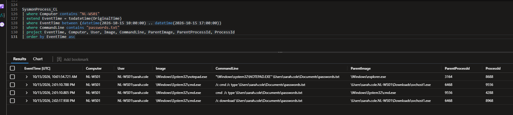

*Evidence: Normal Notepad file access followed by beacon-associated type and download commands for passwords.txt.*

A second `download` command at approximately **14:03:06 UTC** referenced `vpn-access-notes.txt`. The scenario describes both files as transferred via the C2 channel, and the process logs document both commands. Sysmon process creation alone does not establish successful delivery to the remote operator. Both commands are visible in the earlier broad [operator process results](evidence/S04_Q02_secedit_security_policy_configuration.png), which are reused rather than duplicated here.

We separately searched for common archiving and file-staging commands prior to the first download. The results showed `CollectGuestLogs.exe` archiving `VMAgentLogs.zip` as **`NT AUTHORITY\SYSTEM`**, launched by the Azure Guest Agent. No attacker-associated staging operation was identified in that search. The diagnostic ZIP activity should not be interpreted as attacker data staging.

```kusto
SysmonProcess_CL
| where Computer contains "NL-WS01"
| extend EventTime = todatetime(OriginalTime)
| where EventTime between (datetime(2026-10-15 10:00:00) .. datetime(2026-10-15 14:02:17))
| where CommandLine has_any ("zip", "7z", "rar", "tar", "compress", "copy", "xcopy", "robocopy", "move", "makecab", "compact")
| project EventTime, User, Image, CommandLine, ParentImage, ParentProcessId, ProcessId
| order by EventTime asc
```

[Open the saved KQL file](queries/S05_Q05_staging_command_search.kql)

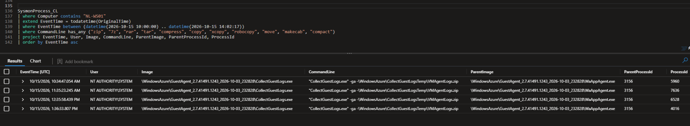

*Evidence: Staging search returning Azure Guest Agent diagnostic ZIP operations rather than attacker archiving.*

### 6. Persistence Through a Second Executable and Run Key

At **15:14:41 UTC**, a command issued through the beacon attempted to upload a payload from a Kali-named path to the compromised workstation, referencing an intermediate file called `sishelper.exe`. The process logs later show a `del /f /q` command aimed at removing that intermediate file. The `upload` command alone did not identify the final persistence filename.

```kusto
SysmonProcess_CL
| where Computer contains "NL-WS01"
| extend EventTime = todatetime(OriginalTime)
| where EventTime between (datetime(2026-10-15 15:00:00) .. datetime(2026-10-15 17:00:00))
| where CommandLine contains "upload" or CommandLine contains "sishelper"
| project EventTime, User, Image, CommandLine, ParentImage, ParentProcessId, ProcessId
| order by EventTime asc
```

[Open the saved KQL file](queries/S06_Q01_persistent_beacon_upload_attempt.kql)

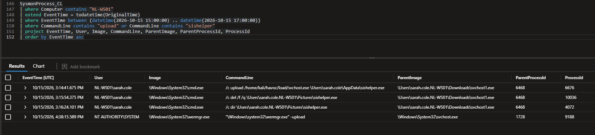

*Evidence: Upload attempt and subsequent commands referencing the intermediate sishelper.exe file.*

Sysmon FileCreate events independently show `sishelper.exe` written under Pictures at **15:15:19 UTC** and **`imageloader.exe`** written to **`Pictures\picture-loader`** at **15:17:39 UTC**. The latter is the final persistent beacon. The image-related folder and filename created a consistent appearance intended to resemble an image-handling utility.

```kusto
SysmonFileCreate_CL
| where Computer contains "NL-WS01"
| extend EventTime = todatetime(OriginalTime)
| where EventTime between (datetime(2026-10-15 15:00:00) .. datetime(2026-10-15 17:00:00))
| where TargetFilename endswith ".exe"
| project EventTime, Computer, Image, TargetFilename
| order by EventTime asc
```

[Open the saved KQL file](queries/S06_Q01_persistent_beacon_file_creation.kql)

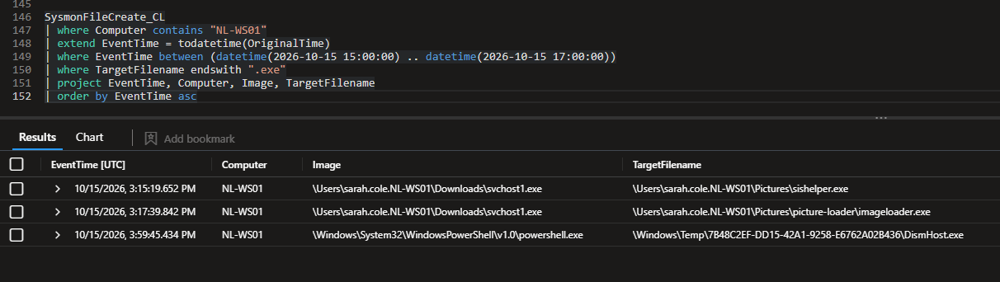

*Evidence: Sysmon file creation confirming imageloader.exe under the picture-loader subdirectory.*

At **15:19:16.248 UTC**, `SysmonRegistryEvent_CL` recorded a `SetValue` action by `reg.exe`. The value was named **`image`** under `HKCU\Software\Microsoft\Windows\CurrentVersion\Run` and pointed to the new `imageloader.exe` file. This confirms the registry-based autostart mechanism was configured. It does not show a subsequent reboot or successful relaunch, which were outside the events cited.

```kusto
SysmonRegistryEvent_CL
| where Computer contains "NL-WS01"
| extend EventTime = todatetime(OriginalTime)
| where EventTime between (datetime(2026-10-15 15:00:00) .. datetime(2026-10-15 17:00:00))
| where TargetObject contains "Run"
| project EventTime, Image, TargetObject, Details, EventType
| order by EventTime asc
```

[Open the saved KQL file](queries/S06_Q04_registry_run_key_persistence.kql)

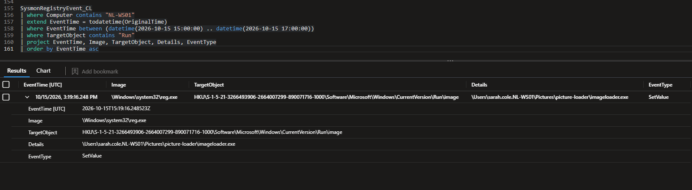

*Evidence: Registry SetValue record linking the image Run value to imageloader.exe.*

### 7. Lateral Movement and Containment Assessment

The scoped network records for `svchost1.exe` showed the two external HTTP destinations above, with no observed connections by that beacon to other internal hosts. This supports **no lateral movement observed in the available beacon telemetry**, not a claim that all possible internal activity was ruled out.

The last network connection in the initial summary appears at **16:46:33 UTC**. The case states the beacon remained active and the Run-key persistence was still in place at the end of the hunt. There was no evidence that host isolation, malware removal, or registry cleanup occurred during the investigation window. The incident was therefore assessed as **not contained**.

## Indicators of Compromise and Investigative Context

| Indicator | Value | Significance |
|---|---|---|
| Attacker source IP | `187.15.135.77` | External source of the successful RDP logon |
| Attacker workstation name | `kali` | Source workstation label in the Type 3 logon event |
| C2 domain | `egravy.com` | DNS lookups by `svchost1.exe` |
| C2 IP addresses | `5.182.33.151`, `185.196.9.213` | Beacon network destinations on TCP/80 |
| Initial malicious process | `\Users\sarah.cole.NL-WS01\Downloads\svchost1.exe` | Windows service-name masquerading, PID `6468` |
| Intermediate file | `\Users\sarah.cole.NL-WS01\Pictures\sishelper.exe` | Created and targeted by a later delete command |
| Persistent executable | `\Users\sarah.cole.NL-WS01\Pictures\picture-loader\imageloader.exe` | Second payload written to disk |
| Persistence value | `HKCU\Software\Microsoft\Windows\CurrentVersion\Run\image` | Autostart value pointing to the persistent executable |
| Targeted files | `passwords.txt`, `vpn-access-notes.txt` | File read and C2 download commands |

The legitimate browser `msedge.exe`, comparison workstation `DESKTOP-AMOL2RQ`, and general-purpose Windows commands were investigative context, **not standalone malicious indicators**.

## MITRE ATT&CK Mapping

The mappings below describe behaviors seen in the evidence, including attempts whose outcomes were not established.

| Technique | Observed behavior |
|---|---|
| **T1021 — Remote Services** | External RDP access to `NL-WS01` |
| **T1078 — Valid Accounts** | Successful use of `sarah.cole`'s credentials |
| **T1204.002 — User Execution: Malicious File** | Browser-parented execution of `svchost1.exe`; precise delivery route unconfirmed |
| **T1036.005 — Masquerading: Match Legitimate Name or Location** | `svchost1.exe` in Downloads and image-themed second payload |
| **T1071.001 — Application Layer Protocol: Web Protocols** | Beacon connections to C2 over TCP/80 |
| **T1059.003 — Command and Scripting Interpreter: Windows Command Shell** | Beacon-associated `cmd.exe` command execution |
| **T1083 — File and Directory Discovery** | `ls`, `dir`, and other system discovery commands |
| **T1098 — Account Manipulation (attempted)** | `net localgroup` / `secedit` commands; no confirmed privilege change |
| **T1552.001 — Unsecured Credentials: Credentials in Files** | Plaintext `passwords.txt` targeted by the attacker |
| **T1041 — Exfiltration Over C2 Channel (command observed)** | `download` commands against two files; remote receipt not independently logged |
| **T1070.004 — Indicator Removal: File Deletion (attempted)** | `del /f /q` against intermediate `sishelper.exe` |
| **T1547.001 — Boot or Logon Autostart Execution: Registry Run Keys** | `image` Run value pointing to `imageloader.exe` |

The challenge's Case File also lists **T1074 — Data Staged**, but the staging query found no attacker-associated archiving or copying. It is not presented as an observed tactic in this report.

## Detection Opportunities

- **Remote access correlation:** Alert on externally sourced RDP logons to employee workstations, particularly when followed by execution of new files from user-writable directories.
- **Process masquerading:** Detect names resembling core Windows services outside expected system paths, especially when spawned by browsers and initiating outbound traffic.
- **Beaconing:** Correlate repeated HTTP connections to uncommon external destinations with DNS queries and the originating process's ancestry.
- **Interactive post-exploitation activity:** Review abnormal child processes from newly launched executables, including repeated `cmd.exe` calls, `net localgroup`, and `secedit.exe`.
- **Credential access and collection:** Detect attempts to read files suggestive of stored credentials and C2-associated download commands.
- **Persistence:** Alert on new executables in user profile subdirectories followed by `HKCU` Run-key changes referencing those files.

## Recommended Response

1. **Isolate `NL-WS01`** to disrupt the active C2 channel and preserve forensic evidence.
2. **Disable and rotate the affected credentials** for `sarah.cole`, revoke remote sessions, and review other systems for reuse or suspicious authentication.
3. **Remove the `image` Run value** under `HKCU\Software\Microsoft\Windows\CurrentVersion\Run` and the associated `imageloader.exe` payload; also remove the original `svchost1.exe` only after appropriate forensic preservation.
4. **Review exposure of `passwords.txt` and `vpn-access-notes.txt`**, including any credentials or VPN details they contain, and rotate impacted secrets.
5. **Restrict externally reachable RDP** behind approved remote-access controls, enforce MFA, and review remote-access logs for additional suspicious sessions.
6. **Reimage or fully remediate the workstation** following evidence collection and validate that the C2 traffic and persistence no longer recur.

---

